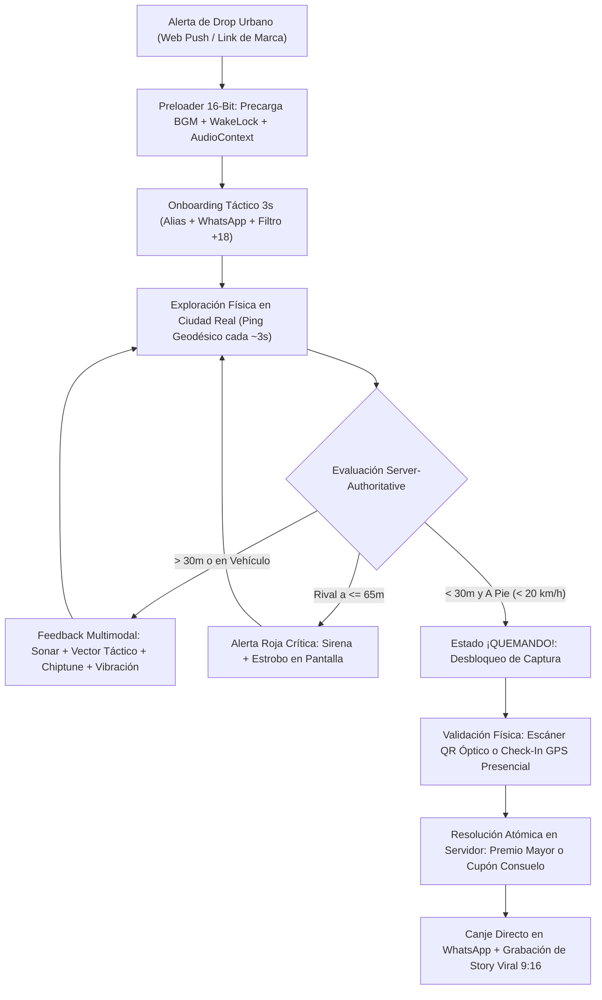
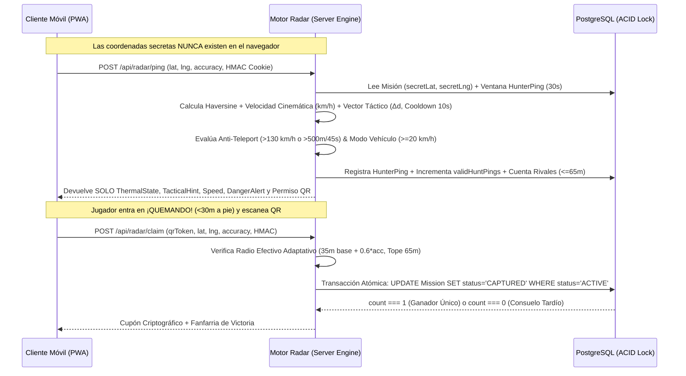

# RADAR QUEST PY — Game Design Document (GDD) & Dossier de Arquitectura Técnica

**Estudio Desarrollador:** CeroUno Studio  
**Título del Proyecto:** Radar Quest PY  
**Género:** Location-Based Arcade Game (LBG) / Real-World Tactical Treasure Hunt / LiveOps ARG  
**Plataforma:** Progressive Web App (PWA) Instant-Play — Mobile-First Vertical `9:16` (`100dvh`) + Emulador de Gabinete en Desktop  
**Dirección de Arte:** 16-Bit Cyberpunk Tactical Mech & Retrofuturistic Arcade  
**Arquitectura de Negocio:** Plataforma SaaS B2B2C Multi-Tenant White-Label  

---

## 1. Visión Ejecutiva y High-Concept Pitch

**Radar Quest PY** transforma ciudades reales en tableros de arcade tácticos de 16 bits. En lugar de exigir descargas pesadas en tiendas de aplicaciones —principal punto de abandono en juegos geolocalizados ocasionales—, el título opera a 60 FPS directamente sobre el navegador móvil como una **PWA de fricción cero**.

El diseño resuelve un problema clásico de los *Location-Based Games* (como *Pokémon GO* o *Geocaching*): **cómo guiar a decenas de jugadores simultáneos hacia un punto secreto en el mundo físico sin revelar las coordenadas en el cliente web, manteniendo tensión competitiva en tiempo real y garantizando equidad frente a trampas de GPS o uso de vehículos.**

En lugar de mostrar un marcador de destino tradicional, el jugador navega el entorno urbano guiándose únicamente por **telemetría térmica ("Frío / Caliente")**, **asistencia táctica de trayectoria cinemática en caminata**, ondas de sonar pixeladas, síntesis de audio chiptune paramétrica y vibración háptica progresiva hasta situarse a menos de 30 metros a pie del objetivo para reclamar la recompensa física o digital.

---

## 2. Ficha Técnica del Motor y Stack

| Capa del Sistema | Tecnología / Implementación | Propósito en el Videojuego |
| :--- | :--- | :--- |
| **Core Runtime** | Next.js 16.4 (Turbopack), React 19.3, TypeScript | Orquestación cliente-servidor, rutas dinámicas multi-marca (`/b/[brand]`) y APIs de baja latencia. |
| **Motor Cartográfico** | MapLibre GL JS 6.16 + Web Workers dedicados | Renderizado vectorial WebGL reprogramado en caliente con estética RPG 16-bit (césped verde vibrante, calles empedradas y casitas modernas con relieve 2.5D) y cámara inclinada (`pitch: 22°`). |
| **Motor Gráfico 2D / VFX** | HTML5 `<canvas>` (`360x640` lógico, `pixelated`) | Loop independiente a **60 FPS** (`requestAnimationFrame`) para spritesheets, ondas Bresenham, fuego, congelamiento estocástico y partículas. |
| **Audio & Síntesis** | Web Audio API + Tri-Stem Adaptive BGM | Sintetizador chiptune procedimental (`square`, `triangle`, `sawtooth`) + crossfade dinámico de 3 capas Synthwave (`100` / `110` / `120 BPM`). |
| ** Sensores Físicos** | Geolocation API, Screen Wake Lock, Vibration API | Rastreo Haversine de alta precisión, pantalla siempre activa en caminata y feedback háptico rítmico. |
| **Visión Artificial (QR)** | WebRTC + Native `BarcodeDetector` + `jsQR` | Escáner óptico en tiempo real acelerado por GPU nativa con fallback automático en CPU. |
| **Motor de Replay Social** | Canvas Compositor (`540x960`) + `MediaRecorder` | Grabación en vivo de partidas en formato vertical `9:16` (MP4/WebM) con HUD retrofuturista incrustado para redes sociales. |
| **Persistencia & Lock Atómico** | PostgreSQL + Prisma ORM 6.19 (con Fallback Local) | Control transaccional ACID para evitar dobles ganadores en milisegundos simultáneos y analítica espacial. |
| **LiveOps & Retención** | Service Workers + Web Push Protocol (`VAPID`) | Alertas push nativas segmentadas por ciudad y marca ante el lanzamiento de nuevos *drops*. |

---

## 3. Diseño de Jugabilidad (Core Gameplay Loop & Sistemas)

### 3.1. El Bucle Principal de Juego (Core Loop)

### 3.2. Escala de Estados Térmicos y Progresión Sensorial

El servidor evalúa la distancia geodésica exacta mediante la fórmula de **Haversine** sobre el elipsoide WGS84 (`R = 6.371.000 m`) entre el jugador y las coordenadas secretas, devolviendo únicamente un estado discreto y un índice de calor (`heatIntensity`):

| Estado Térmico | Umbral de Distancia / Condición | Intensidad | Comportamiento de Juego y Restricciones |
| :--- | :--- | :---: | :--- |
| **`FUERA DE ZONA`** | `> zoneRadiusMeters` (def. `3.500 m`) | `6%` | Jugador fuera del radio operativo de la misión. Sonar lento púrpura y eventos periódicos de congelamiento del avatar. |
| **`CONGELADO`** | `650 m` a `3.500 m` | `24%` | En zona urbana activa pero lejos del objetivo. Anillos celestes lentos y activación del sistema estocástico de escarcha. |
| **`TIBIO`** | `160 m` a `650 m` | `52%` | Acercamiento confirmado en el barrio correcto. Anillos amarillos, desaparece el frío y la música conmuta con crossfade al tema de tensión (`110 BPM`). |
| **`CALIENTE`** | `30 m` a `160 m` *(o `< 30 m` en vehículo `>= 35 km/h`)* | `78%` | Proximidad alta. Se enciende el aura de llamas pixel-art, sube la ganancia del bajo modular de tensión y, si va a alta velocidad, bloquea el avance aquí. |
| **`QUEMANDO`** | **`< 30 m` y velocidad `< 35 km/h` (a pie / tolerancia GPS)** | `98%` | Zona de captura alcanzada con sub-progresión interna no filtrante **`climaxLevel` (`1`: `<30 m`, `2`: `<20 m`, `3`: `<10 m`)** sin exponer distancia exacta en metros. Estalla el tema Synthwave Clímax (`120 BPM`), el personaje salta entre llamas, **se despliega el Modal Flotante Central minimizable (`Ver Radar`) con el Cofre PixelLab** y **se desbloquea la captura instantánea**. |
| **`TELEPORT_ANOMALY`** | Salto `> 500 m` en `<= 45 s` o `> 130 km/h` | `0%` | Penalización Anti-Spoofing activa. Bloquea el progreso de caza y cualquier intento de reclamo. |

### 3.3. Asistencia Táctica de Trayectoria (`TacticalVectorAssistance`)

Mientras la escala térmica comunica proximidad radial estática, un jugador que permanece dentro de una banda amplia (por ejemplo, `TIBIO` entre `160 m` y `650 m`) necesita saber si su rumbo actual sobre la cuadrícula urbana lo acerca o lo aleja del objetivo sin que el servidor revele jamás una brújula exacta ni las coordenadas secretas. El módulo **`TacticalVectorAssistance`** (`src/lib/radar/tacticalVectorAssistance.ts`) resuelve esto analizando la cinemática real de caminata:

* **Ventana Cinemática (`15 s` a `30 s`):** Evalúa en servidor los últimos pulsos válidos a pie (`HunterPing` indexados de los últimos `30 segundos`, velocidad `< 20 km/h`, sin banderas de anomalía, con respaldo `prevTelemetry` hasta `45 s`). Calcula el diferencial radial por paso y neto (`Δd = d_actual - d_anterior`), el recorrido físico acumulado sobre el suelo por Haversine (`groundPathMeters`) y la deriva respecto al punto más cercano alcanzado en la ventana reciente (`driftFromClosest = d_actual - minRecentDistance`).
* **Filtro de Enfriamiento Anti-Spam (`Cooldown 10 s`) y Continuidad Serverless:** Para evitar parpadeos visuales ante fluctuaciones menores del GPS civil, el motor retiene la pista emitida durante `10.000 ms` (`TACTICAL_COOLDOWN_MS`), sincronizando una caché en memoria de instancia (`__rqTacticalCooldownCache`) con un snapshot cliente-servidor (`tacticalStateSnapshot`) resistente al balanceo entre múltiples lambdas en Vercel. El candado se libera de forma inmediata ante cambios de prioridad crítica (activar/salir de modo vehículo, anomalía de teletransporte o entrada a `QUEMANDO`).

| Tendencia / Prioridad | Condición Cinemática en Ventana (`15–30 s`) | Mensajes Temáticos 16-Bits (`TacticalHint.message`) |
| :--- | :--- | :--- |
| **`CLOSING_IN`** *(Acercamiento)* | A pie (`< 20 km/h`) con reducción sostenida (`Δd_neto <= -6 m`, `Δd_paso <= 2.5 m` y mayoría de pasos positivos) o en rango `< 30 m`. | `SEÑAL EN AUMENTO: MANTÉN ESTA DIRECCIÓN` / `VECTOR ÓPTIMO: ACERCAMIENTO DIRECTO AL OBJETIVO` / `SEÑAL EN AUMENTO: OBJETIVO EN RANGO INMEDIATO (<30M)` |
| **`DRIFTING_AWAY`** *(Desvío / Alejamiento)* | Deriva acumulada `>= 15 m` respecto al mínimo reciente sin recuperación inmediata (`15–24.9 m` moderado; `>= 25 m` severo). | `ALEJAMIENTO DETECTADO: CORRIGE RUMBO EN SENTIDO OPUESTO` / `DESVÍO DETECTADO: EL RASTRO QUEDÓ A TUS ESPALDAS` |
| **`NEUTRAL`** *(Rumbo Paralelo / Búsqueda)* | Caminata lateral (`groundPathMeters >= 12 m` con `abs(Δd_neto) < 10 m` y deriva `< 15 m`), calibración inicial o transición suave. | `RUMBO PARALELO: BUSCA UN CRUCE DIRECTO` / `CALIBRANDO VECTOR: CAMINA A PIE PARA FIJAR RUMBO` / `EXPLORANDO SECTOR: MANTÉN CAMINATA CONSTANTE` |
| **`STAGNANT`** *(Estancamiento)* | Ventana `>= 10 s` (o `>= 3` pings) con desplazamiento físico sobre el terreno `< 8 m` en esquina o cuadra. | `ESTANCAMIENTO EN ESQUINA: AVANZA UNA CUADRA PARA TRIANGULAR` |
| **Override Vehicular** *(Prioridad 1)* | Velocidad `>= 20 km/h` (`inVehicleMode = true`); ignora el cooldown y sobrescribe instantáneamente la pista. | `MODO VEHÍCULO ACTIVO: ESTACIONA Y CONTINÚA A PIE PARA FIJAR RUMBO` |
| **Override Anti-Spoof** *(Prioridad 2)* | Detección de salto imposible (`TELEPORT_ANOMALY`). | `ANOMALÍA DE TRAYECTORIA: CAMINA A PIE PARA RECALIBRAR RUMBO` |

### 3.4. Modalidades de Victoria Versátiles (`ValidationMode`)

Cada misión admite tres configuraciones tácticas definibles en vivo por el *Game Master* (administrador de marca):

1. **`QR_SCAN` (Búsqueda de Cartel / Nodo Oculto):** El jugador debe hallar visualmente un código QR físico oculto en el radio de `<30m` y escanearlo desde el visor retro-arcade integrado. Soporta **Nodos QR Reutilizables** (`RQ-NODE-*`), permitiendo a las marcas usar stickers acrílicos permanentes y reasignarles nuevas misiones desde la nube sin reimprimir.
2. **`PRESENTIAL_GPS` (Encuentro en Vivo con Equipo de Marketing):** Pensado para eventos masivos y *drops* relámpago donde un equipo humano aguarda en el punto secreto. Al entrar en `¡QUEMANDO!`, se habilita el botón mecánico esmeralda **`¡LLEGUÉ AL PUNTO!`**, validando la victoria por precisión geodésica instantánea para filmar la entrega en vivo.
3. **`HYBRID` (Modo Dual):** Habilita simultáneamente tanto la validación por proximidad GPS presencial como el escaneo óptico QR.

### 3.5. Psicología de Recompensas y Sistema "Proof of Hunt" (Cero Frustración)

Un riesgo crítico de diseño en las búsquedas del tesoro reales es la **frustración del segundo lugar** (caminar diez cuadras y que otro jugador capture el premio diez segundos antes) o el **robo casual** (un peatón ajeno al juego que ve un QR pegado en un poste y lo escanea por curiosidad). Radar Quest lo resuelve mediante una matriz de tres resultados transaccionales:

* **Premio Mayor (`MAJOR_PRIZE` — Código `MARCA-WIN-XXXXXX`):** Reservado exclusivamente para el **primer jugador exacto** que valide dentro del radio efectivo habiendo cumplido la **Prueba de Caza (`Proof of Hunt`)**: acumular un mínimo configurable de pulsos legítimos de rastreo dentro de la zona (`validHuntPings >= minPingsForMajorPrize`, por defecto `3`) sin banderas de anomalía. Cambia atómicamente el estado de la misión a `CAPTURED`.
* **Consuelo por Llegada Tardía (`CONSOLATION_LATE` — Código `MARCA-LATE-XXXXXX`):** Si la misión acaba de ser capturada por otro rival, todo cazador en ruta que llegue al punto recibe un **Cupón Oficial de Consuelo** (ej. *15% OFF / Beneficio directo*), recompensando su esfuerzo físico en el mundo real.
* **Modo Explorador Curioso (`CONSOLATION_CURIOUS` — Código `MARCA-EXP-XXXXXX`):** Si un transeúnte escanea el QR físico en la calle con la cámara de su teléfono sin haber rastreado la misión en el radar (`validHuntPings < minPingsForMajorPrize`), el sistema le entrega un cupón de bienvenida y capta su registro, **pero mantiene el Premio Mayor intacto y oculto (`ACTIVE`)** para los cazadores legítimos que están compitiendo en el mapa.

### 3.6. Tensión Multijugador en Tiempo Real ("Rival Danger Zone")

El motor cruza en cada pulso la telemetría de todos los jugadores activos en los últimos `90 segundos` (`ACTIVE_HUNTER_WINDOW_MS`). Si uno o más cazadores rivales ingresan a un radio crítico de **`<= 65 metros`** del tesoro (`DANGER_ZONE_METERS`), todos los jugadores reciben una **Alerta Roja de Peligro**: el borde del canvas parpadea con un estrobo carmesí a `3 Hz`, se dispara una sirena bitonal en onda diente de sierra y el HUD notifica cuántos rivales están pisando el área de captura, provocando un pico inmediato de adrenalina en los metros finales.

### 3.7. Micro-Mecánicas Activas, Billetera de Cupones, Polling Adaptativo y Ranking

* **Visibilidad de `Proof of Hunt` y Billetera Persistente ("Mis Cupones"):** El HUD muestra una barra de progreso en tiempo real (`Rastreo X/Y`) junto al premio de la misión y dentro del modal de captura para indicar cuántos pulsos válidos se requieren para el Premio Mayor. Además, la ruta `GET /api/radar/claims` combinada con sincronización en `localStorage` persiste todos los cupones ganados por el jugador en la marca (acceso directo vía botón `<Ticket>` superior con copia rápida de código y enlace a WhatsApp).
* **Polling GPS Adaptativo (`RadarGameClient`) y Bloqueo de Misiones Inactivas (`PAUSED` / `DRAFT`):** En lugar de un intervalo rígido, el cliente ajusta dinámicamente el intervalo de sondeo (`/api/radar/ping`) para equilibrar precisión y batería: `4 s` en `QUEMANDO`/`CALIENTE`, `5 s` caminando en `TIBIO`, `7 s` caminando en `CONGELADO`, `12 s` peatón detenido, `15 s` en `FUERA DE ZONA` y `30 s` cuando la pestaña está en segundo plano (`hidden`), disparando además un pulso inmediato cuando el jugador se desplaza `>= 6 m` desde el último punto enviado o vuelve al foco. Al iniciar en modo GPS real (`gpsMode === "real"`) o regresar desde el simulador, el cliente nunca envía pulsos ni triangulación con la caché local (`rq_last_known_coords`, limitada además a `30 min` para centrado visual) ni con el centro público de respaldo: espera al primer fix real de `navigator.geolocation.watchPosition` (con ventana de estabilización inicial de hasta `3.5 s` si una primera lectura de red/antena supera `180 m`) para evitar falsos `TELEPORT_ANOMALY` en el arranque. Si la misión seleccionada se encuentra en estado `PAUSED` o `DRAFT`, tanto el cliente como `processRadarPing` bloquean el envío/registro de pulsos, mantienen el indicador en estado pausado, ocultando el progreso de `RASTREO`, balizas, triangulación y botones de captura (`¡QUEMANDO!`, `¡LLEGUÉ AL PUNTO!`, `ESCANEAR QR`).
* **Pulso de Triangulación (`POST /api/radar/triangulate`):** Habilidad activa con recarga de servidor de `60 s` que proyecta sobre el canvas durante `4 s` un barrido visual en cono de **`45°`** hacia el sector cardinal (`N`, `NE`, `E`, `SE`, `S`, `SO`, `O`, `NO`) cuando el cazador está dentro de zona y a `>= 45 m` del objetivo, sin revelar coordenadas exactas ni distancia numérica. Al tocar **`PULSO`**, el mapa se recentra automáticamente sobre el cazador (`isUserPanned = false`), restablece el zoom táctico (`16.2`) y alinea el rumbo a Norte (`0°`, salvo con brújula física activa) para evitar que el cono en pantalla proyecte un alcance urbano al alejar manualmente la cámara.
* **Balizas de Ruta (`bonusNodes` — Torres Repetidoras 16-bit PixelLab):** Cada misión activa genera para el cazador 2 antenas repetidoras (`Baliza Alfa` y `Baliza Beta`, renderizadas en `ArcadeMap` con el sprite PixelLab `/sprites/beacon_tower.png`), ubicadas entre **`40%` y `50%` de la distancia entre su punto inicial real de rastreo en la misión y el centro público difuso** (`publicCenterLat/Lng`, nunca `secretLat/Lng`), con desvío lateral (`18°–30°`) para ofrecer rutas alternativas sin exponer el rumbo secreto. Al caminar dentro de `45 m` de una baliza no recolectada, el servidor otorga `+1` punto adicional de *Proof of Hunt* y reduce `-15 s` el cooldown del Pulso de Triangulación.
* **Salón de Cazadores (`GET /api/radar/leaderboard`) y Mi Historial:** Clasificación pública por marca y filtro de ciudad calculada a partir de capturas mayores, capturas totales, menor tiempo desde el primer pulso hasta la captura y pulsos válidos, sin exponer datos privados ni teléfono WhatsApp; incluye pestaña personal con métricas e historial propio del cazador autenticado.

---

## 4. Arquitectura Server-Authoritative y Seguridad Anti-Cheat

Al tratarse de premios físicos con valor económico real, toda la lógica de arbitraje sigue el paradigma **Zero-Trust Client / Server-Authoritative**:

1. **Ofuscación Geodésica Determinista (`computePublicZoneCenter`):** Los endpoints públicos eliminan `secretLat` y `secretLng` a nivel de DTO (`PublicMission`). Para centrar la cámara inicial del mapa en el barrio aproximado sin delatar el escondite en las herramientas de desarrollador (*DevTools Network Inspector*), el servidor calcula un centro público desplazado entre **`180 m` y `270 m`** en un ángulo derivado de un hash determinista de la misión.
2. **Cinemática Anti-Spoofing (`TELEPORT_ANOMALY`):** El servidor compara el vector espacio-temporal contra el ping anterior. Saltos imposibles (`> 500 m` en `<= 45 s` o velocidades `> 130 km/h` en desplazamientos `>= 25 m`) marcan el ping como anomalía, incrementan `anomalyFlags` del jugador y bloquean el reclamo con código `TELEPORT_LOCKED`.
3. **Seguridad Vial y Gobernador de Velocidad (`inVehicleMode`) con Tolerancia de Clímax en `<30m`:** En trayecto abierto entre `20 km/h` y `130 km/h`, el motor detecta desplazamiento en automóvil o motocicleta, congela el techo térmico en `CALIENTE`, impide desbloquear el estado `QUEMANDO` y desactiva el escáner óptico. Sin embargo, al pisar el radio crítico de captura (`< 30 m`), tanto `engine.ts`, `tacticalVectorAssistance.ts` como el HUD (`TacticalVectorReadout`) elevan la tolerancia peatonal de jitter GPS a `< 35 km/h` (`inVehicleMode` solo se activa si `speedKmh >= 35` dentro de `< 30 m`), evitando que picos de rebote GPS deshabiliten `QUEMANDO` o el reclamo a pie.
4. **Tolerancia GPS Adaptativa con Techo Inquebrantable (`calculateEffectiveCaptureRadius`) y Lectura Fresca Obligatoria:** En cañones urbanos (edificios altos o arboledas densas), el GPS civil presenta deriva horizontal. El radio de validación suma el `60%` de la incertidumbre reportada (`accuracy * 0.6`, hasta `+30 m`) sobre la base de `35 m`, pero aplica un **techo estricto de `65 m`** para neutralizar ataques donde un cliente manipulado inyecte `accuracy: 99999`. Adicionalmente, al validar reclamos por QR o botón presencial en modo real (`gpsMode === "real"`), el cliente exige una lectura fresca de alta precisión (`maximumAge: 0` vía `getFreshGpsCoords`) antes de enviar `/api/radar/claim` para impedir rechazos por coordenadas cacheadas.
5. **Identidad Firmada (`HMAC-SHA256`) y Protección del Simulador en Producción:** Las sesiones de cazadores, paneles de comercio y super-administración utilizan firmas criptográficas `HMAC-SHA256` en cookies `HttpOnly` combinadas con tokens de verificación. Los endpoints `/api/radar/ping` y `/api/radar/claim` exigen firma `HMAC-SHA256` válida (retornan HTTP `401` ante sesiones expiradas o ausentes, sin fallback a `body.hunterId`), y `/api/radar/demo-step` queda restringido en `NODE_ENV === "production"` a sesiones autenticadas de la marca propietaria o Super-Admin (salvo `ENABLE_RADAR_DEMO="true"`). La hoja de ruta priorizada de mejoras se documenta en `ROADMAP_MEJORAS.md`.
6. **Privacidad de Identidad en Nick/Alias (`aliasPrivacy.ts`):** Por seguridad y privacidad de los jugadores, está prohibido registrar o mostrar correos electrónicos en lugar del nombre o nick público. `OnboardingModal` (`autoComplete="nickname"`, `validateRegistrationAlias`) y `POST /api/auth/onboard` rechazan cualquier alias con formato de correo electrónico, mientras que `sanitizePublicAlias` limpia en tiempo real cualquier registro histórico o cookie existente (`hmac.ts`, `store.ts`, `engine.ts`, export CSV de leads, HUD, *Salón de Cazadores*, `ViralRecorder`, marcadores en mapa y panel administrativo) para exhibir únicamente el nombre o nick sin dominio de correo.

---

## 5. Dirección de Arte, UI/UX y Cartografía Cyberpunk

### 5.1. Lenguaje Visual: Chasis Táctico Retrofuturista de 16 Bits

Toda la interfaz gráfica (HUD en vivo, preloader, modales de registro, escáner óptico, pantalla de victoria y paneles administrativos) responde a un sistema de diseño cohesivo inspirado en **cabinas de mechas de los años 90 y monitores arcade CRT**:

* **Paneles Achaflanados (`.rf-panel`):** Contenedores oscuros (`#090e1d`) recortados geométricamente a 45° en sus ocho vértices (`clip-path`), con biseles internos especulares y **cuatro tornillos metálicos (`.rf-screw`)** renderizados en las esquinas.
* **Cintas de Precaución Industrial (`.rf-hazard-stripes`):** Franjas diagonales a `-45°` en combinaciones Ámbar/Acero, Cian/Noche y Carmesí/Sombra que señalizan jerarquía visual y estados de alerta.
* **Botonera Mecánica 3D con Respuesta Física:** Cinco variantes cromáticas (`.rf-btn-gold`, `.rf-btn-cyan`, `.rf-btn-crimson`, `.rf-btn-emerald`, `.rf-btn-steel`) construidas con gradientes metálicos de cuatro etapas, sombra dura inferior de `3px` y compresión mecánica `translateY(3px)` al presionarlas.
* **Consola de Lectura Vectorial (`TacticalVectorReadout` / `.rf-tactical-slot`):** Placa achaflanada integrada dentro de la tarjeta inferior `.rf-panel` del HUD vertical `9:16` con altura mínima fija equivalente a dos líneas (`min-height: 52px`, `leading-[18px]`) para evitar que el panel inferior se achique o salte verticalmente entre orientaciones de 1 y 2 líneas o durante la animación de escritura. Encapsulada con `React.memo`, ejecuta un efecto de **tipeo progresivo (*typewriter* a `22 ms/carácter`)** con cursor pulsante y badge de diferencial métrico (`±XM`) sin provocar re-renders en el `<canvas>` a 60 FPS ni alterar la composición de `ViralRecorder`. Aplica código cromático semántico con iconos 100% SVG (`Navigation`, `AlertTriangle`, `Compass`, `Car`): Esmeralda Neón (`#10b981`, `.rf-tactical-closing`) con pulso suave (`2.3 s`) al acercarse, Carmesí (`#ef4444`, `.rf-tactical-drifting`) con parpadeo de precaución (`1.15 s`) al desviarse, y Ámbar Neón (`#f59e0b`, `.rf-tactical-neutral`) en rumbo paralelo, estancamiento, pausa o modo vehículo.
* **Selector Compacto de Misiones por Cercanía y Macro-Distancia (`geo.ts` + Top HUD):** Cuando una marca posee múltiples misiones publicadas, la barra superior del HUD despliega un selector compacto ordenado automáticamente (`rankMissionsByProximity`: misiones `ACTIVE` primero y luego por distancia al centro público `publicCenterLat/Lng`) con preselección automática al recibir el primer fix GPS válido (si no hay `?mission=` ni selección manual previa). Fuera del radio operativo (`FUERA DE ZONA`), la insignia térmica reemplaza el texto genérico mostrando la macro-distancia redondeada y ciudad de destino (`A ~X km / ~Xm de <Ciudad>`) sin revelar las coordenadas secretas.
* **Fidelidad Pixel-Art y Textura CRT:** Regla global `image-rendering: pixelated; crisp-edges;` sobre todos los lienzos y superposición `.crt-scanlines` de `4px` de paso que unifica mapa vectorial, sprites y tipografía.
* **Política de Iconografía 100% Vectorial SVG:** Prohibición absoluta de emojis del sistema operativo en toda la interfaz visual; cada indicador térmico, emblema de marca, control de audio y pin de mapa se dibuja con vectores SVG puros para garantizar nitidez idéntica en cualquier dispositivo.

### 5.2. Arquitectura Tipográfica de Cuatro Niveles

1. **`Handjet` (Display Modular Pixel/Sci-Fi):** Cabeceras, botonera 3D, placas remachadas (`YOU WON`, `SIGN IN`, `REWARDS :`) y alerta de impacto en peso ExtraBlack (`900`) para el estado **`¡QUEMANDO!`**.
2. **`Press Start 2P` (8/16-Bit Arcade Puro):** Micro-etiquetas de gabinete, insignias de hardware y botón de arranque del preloader.
3. **`VT323` (Terminal Fósforo Monoespaciada):** Lecturas de telemetría, consola typewriter de asistencia vectorial (`TacticalVectorReadout`), porcentajes de carga y diagnósticos de sistema.
4. **`Space Grotesk` (Geométrica Técnica):** Cuerpos de texto, pistas narrativas y formularios de gestión LiveOps de lectura rápida bajo luz solar directa.

### 5.3. Reprogramación Cartográfica en Tiempo Real (`ArcadeMap`)

En lugar de utilizar un mapa comercial genérico que rompería la inmersión del videojuego, `ArcadeMap` intercepta el árbol de capas vectoriales de MapLibre al cargar el estilo y ejecuta un *shader/paint pass* completo:

* **Limpieza Quirúrgica anti-distracción:** Oculta dinámicamente todos los puntos de interés comerciales ajenos (`poi`, `aeroway`, `housenumber`), dejando únicamente la geometría urbana y los nombres de calles con texto blanco puro y halo negro de `2.2px` para orientación inmediata al caminar.
* **Generador de Texturas Pixel-Art 16-Bit en Tiempo Real (`mapTextures.ts`):**
  * Para evitar polígonos vectoriales planos y artificiales, el motor genera directamente en memoria typed arrays `ImageData` con baldosas repetitivas (`fill-pattern` / `background-pattern`):
    * *Césped Vivo 16-Bit (`rpg-grass-pattern` — 32x32):* Manto verde con dithering orgánico, 8 mechones de hierba con volumen de 3px y micro-flores silvestres (margaritas blancas y dientes de león amarillos).
    * *Bosque y Parques (`rpg-park-forest-pattern` — 32x32):* Follaje denso en verde profundo con sombras de copas.
    * *Agua con Olas (`rpg-water-pattern` — 32x32):* Celeste cristalino con crestas y ondas de agua pixeladas blancas.
    * *Techos Modernos 16-Bit (16x16):* Baldosas de losa blanca con tragaluces, pizarra grafito con unidades HVAC, terrazas de madera teca con reposeras, celdas fotovoltaicas solares azules y azoteas verdes sustentables.
    * *Vegetación y Árboles 16-Bit Procedimentales (`rpg-trees-layer`):* Capa de símbolos WebGL acelerada por GPU (`minzoom: 12`, sincronizada en `load`, `moveend`, `zoomend` e `idle`) que siembra árboles y arboledas aleatorias deterministas mediante hash espacial (`~38 m` con niveles discretos de densidad LOD para zooms alejados sin perder anclaje):
      - *Árbol Redondo Verde Oscuro (`rpg-tree-round-dark` — 24x28 px):* Tronco con raíces y copa redondeada en 3 lóbulos.
      - *Árbol Redondo Verde Claro (`rpg-tree-round-light` — 24x28 px):* Copa verde lima luminosa.
      - *Pino / Conífera (`rpg-tree-pine` — 20x28 px):* Silueta cónica en 3 niveles de agujas.
      - *Arbusto de Jardín (`rpg-shrub` — 16x14 px):* Matas bajas redondeadas en veredas y patios.
      - Anclaje inferior (`icon-anchor: "bottom"`) con ordenamiento en profundidad 2.5D y etiquetas de calles priorizadas por encima.
  * *Limpieza Total de Cruces:* Se ocultan completamente las líneas catastrales de frontera (`boundary`) para eliminar interferencias anaranjadas en esquinas.
  * *Selector Dual en Tiempo Real (`rpg-16bit` <-> `cyberpunk-dark`) y Armonización HUD:* El jugador puede alternar en vivo entre el mapa RPG diurno 16-bit (`.rf-hud-day` y `.rf-footer-day` con paneles translúcidos de alto contraste bajo luz solar) y el mapa nocturno Cyberpunk (`.rf-footer-night`).
  * *Controles Cartográficos Táctiles 100% SVG:* Controles flotantes laterales en `ArcadeMap` para **Re-centrar en mí** (reactiva seguimiento automático tras explorar libremente con `dragstart`), **Brújula en Tiempo Real** (rotación vía `DeviceOrientationEvent` con solicitud de permiso en iOS) y **Linterna (Flash/Torch)** mediante `MediaTrackConstraints` dentro de `ArcadeQrScannerModal` para escaneos nocturnos.
* **Jerarquía Cromática RPG 16-Bit con Casitas Modernas:**
  * *Fondo y Terreno General:* Césped verde vibrante 16-bit (`#5eb83a` / `#65be41`), evocando el estilo nostálgico de clásicos retro (Zelda / Pokémon SNES).
  * *Parques, Plazas y Arboledas:* Verde bosque denso (`#3e8c24`), aportando riqueza visual y contraste natural.
  * *Ríos, Lagos y Bahías:* Celeste cristalino RPG (`#4ebaf7`) con orillas y cauces delimitados en azul profundo (`#2582bf`).
  * *Red de Calles y Senderos:*
    * *Senderos Peatonales y Pasajes de Parque:* Tierra y adoquín claro (`#c49c66`, cordón `#5c3d22`).
    * *Calles Residenciales / Barriales:* Pavimento urbano gris claro / empedrado (`#8c96a3`, cordón cuneta `#4a5563`).
    * *Avenidas Secundarias y Primarias:* Asfalto urbano (`#56606f` / `#434c58`, cordón `#334155`).
    * *Autopistas y Rutas Rápidas:* Asfalto carbón (`#2b323c`, cordón `#1e293b`).
  * *Casitas y Edificios Modernos (Arquitectura 2.5D en 6 Estilos Contemporáneos):*
    1. *Minimalista Blanco Hormigón:* Techo `#e8ecf2`, fachada pared `#475569`.
    2. *Pizarra Antracita / Techo Plano:* Techo `#334155`, fachada pared `#1e293b`.
    3. *Terraza Deck de Madera Teca:* Techo `#bf8a58`, fachada pared `#5c3d22`.
    4. *Azul Acero Vidrio Solar Templado:* Techo `#2d6391`, fachada pared `#17334d`.
    5. *Azotea Verde Sustentable (Rooftop Garden):* Techo `#4d8024`, fachada pared `#27420f`.
    6. *Caliza Arena Contemporánea:* Techo `#d8c8b2`, fachada pared `#6b5945`.
    * *Relieve y Contornos:* Desplazamiento isométrico de techo `fill-translate: [-2.5, -2.5]` proyectando la pared frontal inferior y contornos nítidos estilo dibujo animado / pixel-art.
  * *Textura CRT:* Scanlines analógicas sutiles (`opacity: 0.18`), integrando el estilo visual arcade.

---

## 6. Sistema de Animación 2D, Sprites y Efectos Visuales (VFX)

El componente `RadarCanvasOverlay` opera sobre una matriz lógica fija de **`360x640` píxeles** sin suavizado bilinear (`imageSmoothingEnabled = false`) a **60 fotogramas por segundo constantes**, leyendo los cambios de estado desde referencias en memoria (`useRef`) para que las actualizaciones de red GPS nunca reinicien ni entrecorten las animaciones.

### 6.1. Avatar del Cazador y Máquina de Estados Animada

El protagonista es un **Cazador Urbano Cyberpunk de 16 bits** (`48x48 px` base, vista *low top-down*, capucha oscura, visor cian luminiscente y mochila exploradora con antena de radar):

1. **Estado en Reposo / Quieto (`IDLE` — 4 Direcciones):** Cuando la velocidad GPS es inferior a `1.4 km/h` o el jugador se detiene, el cazador fija sus pies en el piso en su pose direccional correspondiente (`hunter_south`, `hunter_north`, `hunter_east` o `hunter_west`), cancelando el ciclo de caminata y ejecutando una micro-respiración orgánica de reposo (`idleBob`) de 1px cada ~1.2s sin desplazarse. Conserva el último rumbo al que caminaba.
2. **Estado de Caminata Activa (`WALK` & Rumbo GPS 4D Nativo):** Al detectar velocidad real de desplazamiento a pie (`speedKmh >= 1.4 km/h`), el motor calcula el rumbo geodésico exacto (*bearing*) a partir de las coordenadas del GPS (`calculateBearingDegrees`) orientando al avatar en 4 cuadrantes (`north`, `south`, `east`, `west`). Para las 4 direcciones se ciclan spritesheets nativos dedicados de **9 fotogramas generados en PixelLab** (`walk_south`, `walk_north`, `walk_east`, `walk_west`) a cadencia proporcional a la velocidad de marcha, eliminando desplazamientos artificiales.
3. **Estado de Euforia en `¡QUEMANDO!` (`jump_south` — 9 Frames):** Al pisar el radio de `<30m` a pie, el motor conmuta instantáneamente al spritesheet de celebración donde el personaje **salta en su lugar con ambos brazos en alto** a `~12 FPS` (`tick / 5`, escala ampliada a `48x48 px`). El personaje apoya sus pies limpiamente de forma directa sobre la textura del terreno sin ninguna base rectangular artificial en el piso.
4. **Estado de Conducción (`Cyber-Car 16-Bit`):** Si el jugador supera los `20 km/h`, el avatar humano es reemplazado por un vehículo cyberpunk pixel-art renderizado procedimentalmente con los colores corporativos de la marca activa, parabrisas neón, faros delanteros y suspensión oscilante.
5. **Mecánica Estocástica de Congelamiento ("Freeze & Shiver"):**
   * Activa cuando el jugador se encuentra lejos del tesoro (`CONGELADO` o `FUERA DE ZONA`) caminando.
   * **Temporización No-Repetitiva (Espaciado Mayor):** Para evitar fatiga visual o sonora mientras el jugador camina varias cuadras, el primer congelamiento ocurre tras una ventana inicial de exploración de ~15 segundos (900 frames), con una duración cómica breve de 1.5 s a 2.0 s (90–120 frames), seguido de intervalos libres ampliamente espaciados de 30 s a 65 s (1.800–3.900 frames a 60fps). Al salir y reingresar a zona fría, el temporizador aguarda al menos 30 s a 50 s.
   * **Composición Visual y Sonora del Frío:** Durante el estado `FROZEN`, la animación de caminata se clava en el fotograma exacto en que lo sorprendió la helada; el sprite sufre un **temblor involuntario de alta frecuencia (*shiver*)** de `±1px`; queda encapsulado dentro de un **prisma cristalino de hielo translúcido** con biseles de refracción blancos/cian, carámbanos de escarcha, vaho gélido saliendo del visor y la onomatopeya pixel-art **`¡BRRR!`**. En el milisegundo exacto de entrada se dispara el efecto sonoro dedicado **`sfx_freeze.mp3`** (ráfaga de viento gélido, crujido de escarcha y destello FM chiptune de 3 segundos) con triple vibración háptica `[40, 30, 60] ms`.
   * **Deshielo Automático:** Al finalizar automáticamente la ventana de congelamiento (~1.8 s a 2.6 s) o al abandonar el área fría, el prisma se deshace liberando esquirlas de hielo en abanico radial sin requerir interacción táctil sobre el sprite.

### 6.2. Sonar Bresenham, Aura Ígnea y Partículas

* **Ondas de Sonar Cuantizadas (`drawPixelCircle`):** Trazado trigonométrico redondeado a bloques discretos de `3x3 px`. La cantidad de ondas simultáneas escala de `2` (`FUERA DE ZONA`) a `5` (`QUEMANDO`), mientras la velocidad de expansión se multiplica por `5.7x` (`0.45` a `2.6 px/frame`).
* **Aura de Fuego de 16 Bits (`flames_sheet.png`):** Spritesheet dedicado de **8 fotogramas** (`68x103 px` por celda, 12 FPS, rampa pura de 4 colores sin dithering) anclado al pivote de los pies del personaje en estados `CALIENTE` y `QUEMANDO`.
* **Emisor de Brasas Ascendentes:** Sistema de partículas ligero a 60 FPS alineado a sub-grilla de `2px` que inyecta chispas incandescentes (`#ff0055`, `#fb923c`, `#fde047`, `#ffffff`) con desvanecimiento alfa lineal según su tiempo de vida.
* **Escena de Victoria (`PixelVictoryCanvas`):** Lienzo independiente en el modal de captura con lluvia perpetua de 34 chispas multicolor y un **Trofeo Dorado 16-Bit** (o Medalla Explorador Cian) levitando en el centro.

### 6.3. Clímax de Captura y Modal Flotante de Victoria (PixelLab Asset)

Para resolver de raíz el riesgo de que el jugador llegue físicamente al punto y no perciba con claridad inmediata que alcanzó la meta, al entrar en **`¡QUEMANDO!`** (`< 30 m`), el juego despliega un **Modal Flotante Central de Victoria** (`.rf-victory-banner-frame`):
* **Cofre del Tesoro Victorioso de 16 Bits (`golden_chest_victory.png`):** Sprite de 64x64 píxeles generado con **PixelLab**, con tapa entreabierta, gemas luminosas, herrajes de oro y resplandor radial con animación de levitación vertical continua (`@keyframes rfVictoryChestFloat`).
* **Botón Gigante de Captura de Un Toque:** Destaca visualmente el método de validación activo (`ESCANEAR CÓDIGO QR AHORA` o `¡LLEGUÉ AL PUNTO! REGISTRARME`) con sombras de neón dinámicas para que el cazador complete el reclamo sin buscar controles en el HUD.
* **Bifurcación Semántica (Premio Mayor vs. Premio de Consuelo):** Si la misión está `ACTIVE`, el modal anuncia el premio mayor y llama a la captura inmediata. Si la misión ya fue capturada por otro cazador (`status === 'CAPTURED'`), el modal se despliega igualmente pero informa con badge de alerta táctica (`PREMIO MAYOR YA RECLAMADO`) el alias del ganador (`winnerAlias`) y ofrece botones directos para reclamar el **Premio Oficial de Consuelo** por haber llegado a pie al lugar físico.
* **Control de Descarte y Cierre Sutil:** Si el usuario desea continuar visualizando el mapa y las animaciones antes de escanear, puede minimizar el banner con un botón `X` de bajo contraste, manteniendo el acceso a los botones de captura en el zócalo inferior.

---

## 7. Diseño Sonoro, Síntesis Chiptune y Retroalimentación Háptica

### 7.1. Sincronización de Arranque y Música Synthwave Adaptativa (BGM)

Los navegadores modernos bloquean cualquier reproducción de audio automática previa a una interacción humana (*Autoplay Policy*). Radar Quest convierte esta restricción técnica en parte de la fantasía arcade mediante **`RadarPreloader`** y un motor musical dinámico de **tres capas horizontales** en `ArcadeHardwareController`:

1. **Precarga Triple en Paralelo:** El documento raíz inyecta `<link rel="preload" as="audio">` para `/audio/bgm.mp3`, `/audio/bgm_tension.mp3` y `/audio/bgm_climax.mp3` mientras el preloader llena la barra segmentada de 16 bloques.
2. **Desbloqueo Táctil Silencioso para Transiciones Manos Libres:** Al presionar **`[ INICIAR RADAR ]`**, el gesto del jugador inicializa el `AudioContext`, arranca la pista activa en el milisegundo cero y desbloquea en silencio las pistas inactivas para que los navegadores móviles (iOS Safari y Android Chrome) permitan conmutar canciones automáticamente por GPS mientras el jugador camina sin tocar la pantalla.
3. **Re-Secuenciación Horizontal con Crossfade (`syncBgmWithThermalState`):**
   * **Capa 1 — Exploración (`/audio/bgm.mp3` — `100 BPM`, ganancia `0.35`):** Synthwave analógico nostálgico con sintetizadores cálidos y percusión 808 suave durante los estados lejanos (`FUERA DE ZONA` y `CONGELADO`).
   * **Capa 2 — Tensión Táctica (`/audio/bgm_tension.mp3` — `110 BPM`, ganancia `0.38` a `0.42`):** *Dark Synthwave* con línea de bajo modular pulsante y percusión rítmica de reloj al ingresar a **`TIBIO`** o **`CALIENTE`**, mediante un crossfade progresivo de `~810 ms`.
   * **Capa 3 — Clímax de Cacería (`/audio/bgm_climax.mp3` — `120 BPM`, ganancia `0.45`):** *Upbeat 80s Arcade Synthwave* triunfal con metales sintéticos y bajo rápido pulsante al pisar el radio de **`¡QUEMANDO!`** (`< 30 m` a pie), disparando desde el compás inicial con un crossfade rápido de impacto (`~540 ms`) sincronizado con el salto de celebración y las llamas del personaje.

### 7.2. Sintetizador Chiptune Procedimental (`ArcadeHardwareController`)

Todos los efectos de sonido (SFX) se sintetizan matemáticamente en tiempo de ejecución mediante osciladores nativos de `Web Audio API` con envolventes de caída exponencial (`exponentialRampToValueAtTime`), logrando **0 KB de peso adicional en red** y respuesta instantánea:

| Evento / Estado | Forma de Onda | Secuencia de Frecuencias (Hz) / Notas | Patrón Háptico (`ms`) | Intención Psicoacústica y Consumo Energético |
| :--- | :---: | :--- | :--- | :--- |
| **`FUERA DE ZONA`** | `triangle` | `165 Hz` (E3) | Desactivado (0 ms) | Tono grave hueco que comunica lejanía espacial. |
| **`CONGELADO`** | `square` | `262 Hz` (C4) | Desactivado (0 ms) | Pulso corto cristalino sonoro (vibración desactivada en pings rutinarios para ahorro crítico de batería). |
| **`TIBIO`** | `square` | `392 -> 440 Hz` (G4 - A4) | Desactivado (0 ms) | Intervalo de segunda mayor ascendente sonoro sin vibración mecánica. |
| **`CALIENTE`** | `square` | `523.25 -> 659.25 -> 783.99 Hz` (C5 - E5 - G5) | Desactivado (0 ms) | Tríada mayor brillante sonora sin drenaje por motor háptico. |
| **`QUEMANDO`** | `square` | `784 -> 988 -> 1175 -> 1568 Hz` (G5 - B5 - D6 - G6) | Desactivado (0 ms) | Arpegio agudo de máxima urgencia sonora sin vibración rítmica en pings. |
| **`TELEPORT_ANOMALY`** | `sawtooth` | `220 -> 130 Hz` (A3 -> C3) | Desactivado (0 ms) | Caída áspera disonante de error/bloqueo de seguridad. |
| **Peligro Rival (`<=65m`)** | `sawtooth` | `880 -> 587 -> 880 Hz` (A5 - D5 - A5) | `[150, 50, 150, 50, 150]` | Sirena de alarma táctica que corta la mezcla musical con háptico de emergencia. |
| **Power-Up Inicio** | `square` | `330 -> 440 -> 554 -> 659 Hz` (La Mayor) | `[50, 30, 80]` | Confirmación energética única de conexión al sistema. |
| **Fanfarria de Victoria** | `square` | `523.25 -> 659.25 -> 783.99 -> 1046.5 Hz` (C5 -> C6) | `[100, 40, 100, 40, 300]` | Clímax clásico arcade con octava superior y ráfaga háptica triunfal. |
| **Frizado / Escarcha** | `sfx_freeze.mp3` | Viento gélido + crujido de hielo + shimmer FM | `[40, 30, 60]` | Evento estocástico al congelarse el cazador en `CONGELADO`/`FUERA DE ZONA`. |
| **Audio Inteligente por Estado** | `triggerSmartThermalFeedback` | Sonorización selectiva en transiciones de estado y pulsos clave (`12s`/`22s`) | `[0]` | Evita fatiga auditiva en caminatas largas manteniendo silencio en estados estables lejanos. |
| **Pulso / Baliza de Ruta** | `sine` / `triangle` | Barrido radial `440->988 Hz` (`playTriangulationSweepSound`), Pickup `659->1318 Hz` (`playBonusBeaconPickupSound`) | `[45..90]` | Micro-recompensas táctiles y sonoras exclusivas de acciones voluntarias del jugador. |
| **Escaneo QR Exitoso** | Chiptune synth | Tono confirmatorio de validación de tesoro | `[80, 40, 80]` | Confirmación háptica y visual instantánea al capturar el objetivo. |

---

## 8. Motor de Crecimiento Orgánico: Grabadora Viral 9:16 In-Game

Para convertir a cada jugador en un creador de contenido orgánico durante la cacería sin depender de capturadoras de pantalla externas, **`ViralRecorder`** integra un estudio de composición de video dentro del propio HUD:

* **Pipeline de Composición Audio + Video en Vivo (`540x960 px`, 30 FPS, hasta 15s):** Combina en tiempo real el lienzo WebGL del mapa, el lienzo pixel-art del personaje/llamas/ondas, líneas CRT, corchetes de mira neón, panel superior con indicador `REC` parpadeante, placa 3D de estado térmico calibrada (`CALIENTE 30-160M`, `QUEMANDO <30M`, etc.), barra de lectura táctica (`tacticalHintMessage` / `Proof of Hunt`), tarjeta inferior patrocinada y mezcla en tiempo real de música BGM adaptativa más SFX chiptune vía `MediaStreamAudioDestinationNode` (`getRecordingAudioTracks`).
* **Codificación Multiplataforma y Web Share:** Detecta soporte nativo `video/mp4` (iOS Safari) o `video/webm;codecs=vp9` (Android/Chrome, inyectando cabeceras de duración exacta con `fix-webm-duration`), presenta un modal retrofuturista de vista previa inmediata y permite compartir el archivo directamente en Instagram Stories, TikTok o WhatsApp mediante `navigator.share`.

---

## 9. Herramientas de Game Master, LiveOps y Analítica Espacial

El ecosistema incluye dos consolas operativas completas diseñadas bajo el mismo lenguaje visual retrofuturista:

### 9.1. Centro de Comando de Marca (`/b/[brand]/admin`)
Protegido mediante PIN de 6 dígitos firmado, otorga a cada comercio o director de evento control en tiempo real sobre sus activaciones:
* **Gestión Integral del Ciclo de Vida de Misiones:** Creación (descontando 1 crédito del balance), **edición en vivo** (reubicación del punto secreto con recálculo automático del centro difuso, cambio de premios, pistas o modo de validación), pausa/reactivación y **eliminación segura** (con reembolso automático del crédito si la misión no había sido capturada).
* **Parser Universal de Coordenadas (`extractCoordinatesFromInput`):** Permite fijar el escondite arrastrando el pin en el mapa interactivo o pegando enlaces crudos de Google Maps (`!3d!4d`, `@lat,lng`) y ubicaciones compartidas de WhatsApp, además de presets directos para 9 ciudades clave de Paraguay (*Encarnación, Asunción, Ciudad del Este, San Lorenzo, Luque, Villarrica, Coronel Oviedo, Pedro Juan Caballero y Pilar*).
* **Radar de Monitoreo en Vivo y Mapa de Calor BI (`Heatmap`):** Muestra en tiempo real los pines de todos los cazadores compitiendo en la calle (distinguiendo peatones vs. vehículos y su distancia exacta al objetivo) junto con una capa de densidad térmica histórica de todos los `HunterPing` registrados para evaluar qué cuadras generaron mayor tráfico peatonal.
* **KPIs de Conversión, Exportación CRM y Web Push:** Métricas automáticas de cazadores únicos, tiempo promedio de captura en minutos, tasa de conversión de reclamos, descarga de leads verificados en CSV y botón de disparo de notificaciones **Web Push** a los suscriptores de esa ciudad.

### 9.2. Consola Maestra de Estudio (`/admin/super`)
Panel exclusivo de **CeroUno Studio** para aprovisionamiento multi-tenant: alta y configuración estética de nuevas marcas clientes (paleta primaria/secundaria, iconografía SVG, restricción de edad `+18`, línea de WhatsApp de canje y PIN), monitoreo global y libro mayor auditable de transacciones de créditos (`CreditTransaction`).

### 9.3. Simulador de Telemetría para QA y Demostraciones Comerciales
El HUD incorpora una consola de simulación para diseño de niveles y presentaciones en vivo que permite inyectar estados controlados (`CONGELADO`, `TIBIO`, `CALIENTE`, `QUEMANDO`, `VEHICLE`, `TELEPORT`) en escritorio o sala de reuniones, verificando toda la cadena audiovisual, háptica, pistas vectoriales (`TacticalHint`), anti-cheat y de escaneo sin requerir desplazamiento físico durante una demostración ante inversores o clientes.

